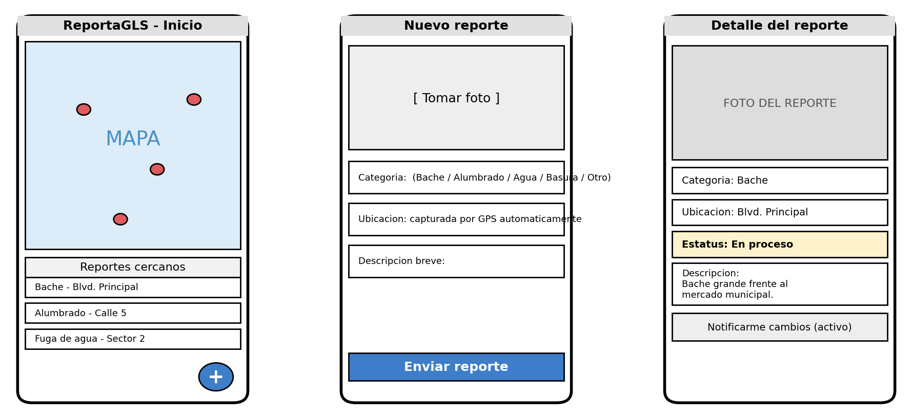

# UNIVERSIDAD AUTÓNOMA DE SINALOA

## LICENCIATURA EN INGENIERÍA EN SOFTWARE

### DESARROLLO DE APLICACIONES NATIVAS

**Act.1.3:** CONCEPTUALIZACIÓN DEL PROYECTO INTEGRADOR

---

## Datos generales

| | |
| --- | --- |
| **Nombre del equipo:** | GLS Devs |
| **Integrantes:** | José Aldair García Valdez |

| Nombre alumno(a): | Correo electrónico |
| --- | --- |
| José Aldair García Valdez (L) | 23122625.garcia@ms.uas.edu.mx |

*\* agreguen una (L) quien va fungir como líder del proyecto.*

| Nombre de la App tentativa |
| --- |
| **ReportaGLS** |

| Eslogan |
| --- |
| **Tu comunidad, tu voz: reporta y mejora Gabriel Leyva Solano** |

---

## Descripción del problema

### Situación actual

*Describan claramente la problemática o necesidad en su entorno (universidad, comunidad, comercio, etc.).*

En la comisaría de Gabriel Leyva Solano, Guasave, Sinaloa, actualmente no existe un canal formal y organizado para que los habitantes reporten fallas en los servicios públicos básicos, como baches en las calles, luminarias apagadas, fugas de agua potable o acumulación de basura en la vía pública. Los vecinos suelen reportar estas fallas mediante llamadas telefónicas a la sindicatura, comentarios en grupos de Facebook de la comunidad o de boca en boca, lo que provoca que muchos reportes se pierdan, se dupliquen o simplemente nunca lleguen a la autoridad correspondiente. Además, quien hace el reporte no tiene forma de dar seguimiento ni de saber si su reporte fue recibido o atendido.

### Personas afectadas

*(seleccionar opciones)*

- [ ] Estudiantes
- [ ] Docentes
- [x] Comerciantes
- [ ] Clientes
- [x] Comunidad en general
- [ ] Otros: _____________________

### Evidencia del problema

*Mencionen ejemplos, observaciones o situaciones que demuestren que el problema existe.*

Se han identificado baches de consideración sobre el bulevar principal y calles aledañas al centro de Gabriel Leyva Solano que llevan meses sin reparación. En publicaciones del grupo de Facebook de la comunidad es común encontrar quejas de vecinos sobre luminarias fundidas desde hace semanas y fugas de agua que generan encharcamientos, sin que exista una respuesta clara de cuándo serán atendidas. Comerciantes de la zona han comentado que los baches frente a sus negocios afectan el acceso de clientes y provocan daños a los vehículos.

### Declaración del problema

Los habitantes de Gabriel Leyva Solano, Guasave, Sinaloa, no cuentan con un medio digital, centralizado y con seguimiento, para reportar fallas en los servicios públicos de su comunidad, lo que provoca que los problemas tarden más tiempo en ser atendidos y que la ciudadanía pierda confianza en el proceso de reporte.

### Descripción general de la aplicación resolviendo el problema identificado

Se propone el desarrollo de ReportaGLS, una aplicación móvil nativa (Android) que permitirá a cualquier habitante de Gabriel Leyva Solano generar un reporte de una falla de servicio público en pocos pasos: tomar una fotografía de la evidencia con la cámara del dispositivo, seleccionar una categoría (bache, alumbrado, agua, basura, otro), capturar automáticamente su ubicación mediante el GPS del teléfono y agregar una breve descripción. El reporte se agregará a un mapa/lista visible para toda la comunidad y contará con un estatus (Recibido, En proceso, Resuelto) que el usuario podrá consultar en cualquier momento desde su historial de "Mis reportes", recibiendo una notificación push cuando su estatus cambie. Se eligió el desarrollo nativo porque la aplicación depende directamente de servicios del dispositivo (cámara, GPS de alta precisión y notificaciones push) que un desarrollo nativo aprovecha de forma más eficiente, rápida y confiable que una alternativa web o híbrida; además, el almacenamiento local del dispositivo permitirá crear un reporte sin conexión a internet (situación frecuente en algunas zonas de la comunidad) y sincronizarlo automáticamente en cuanto se recupere la señal de datos. Para hacer viable el proyecto en un periodo de 15 semanas trabajando de forma individual, el alcance se limita a un producto mínimo viable: registro/inicio de sesión simple, creación y consulta de reportes, mapa/lista de reportes cercanos, historial de "Mis reportes" y actualización manual del estatus por parte de un usuario administrador (simulando el rol del ayuntamiento).

### Boceto inicial

*Deberán tener algunas bocetos iniciales de la aplicación a desarrollar.*

A continuación se muestran los bocetos iniciales (wireframes de baja fidelidad) de las tres pantallas principales de la aplicación: (1) Pantalla principal con mapa y lista de reportes cercanos, (2) Formulario para crear un nuevo reporte con foto, categoría y ubicación por GPS, y (3) Pantalla de detalle de un reporte con su estatus.

